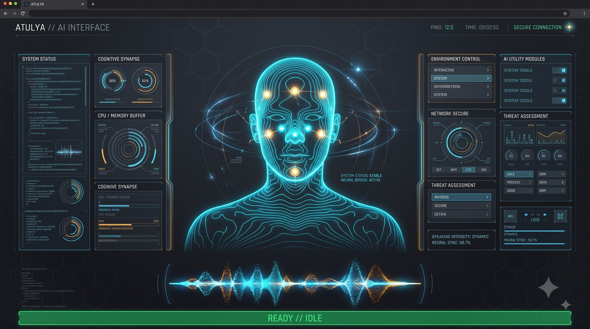
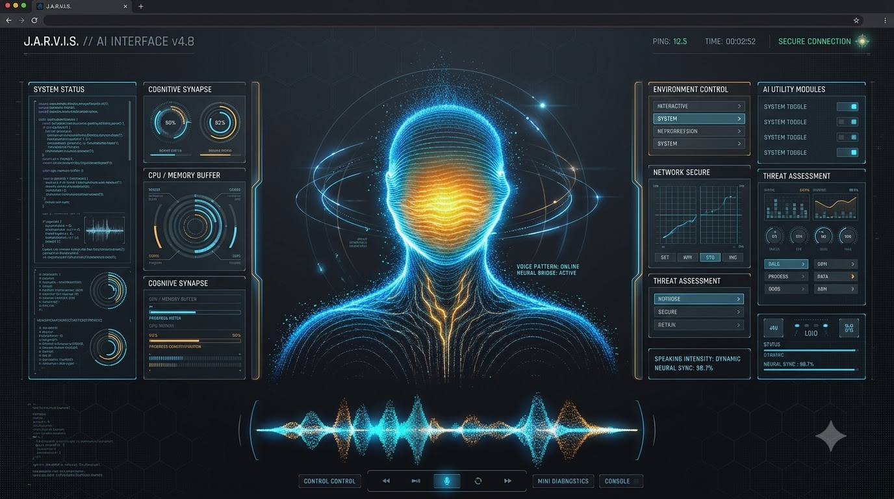
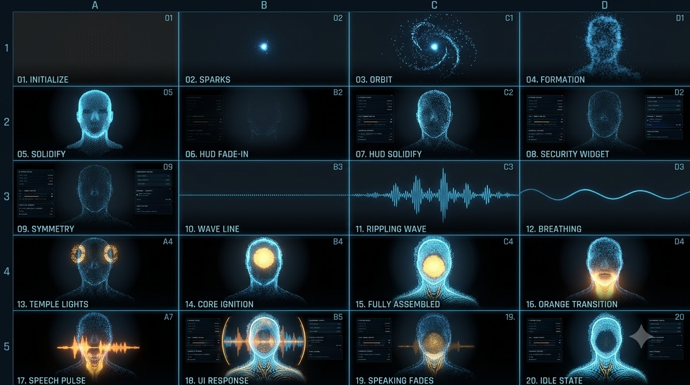
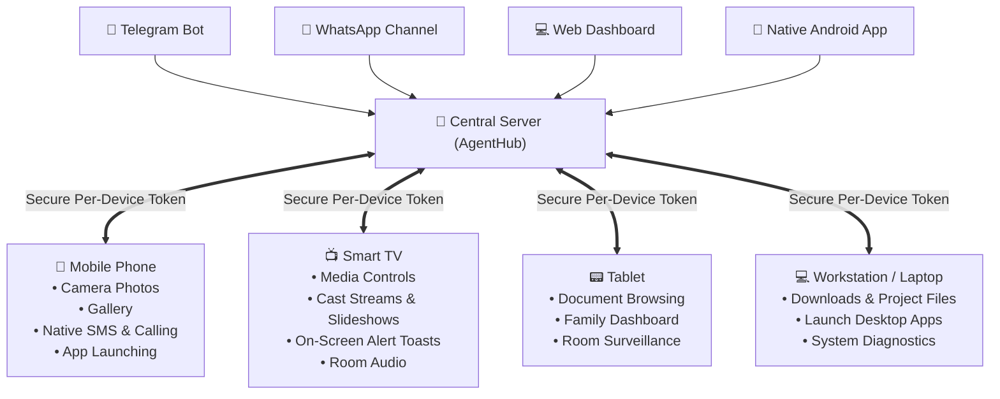

<!-- Hero Banner -->
<div align="center">
  
</div>

<div align="center">
  <h1>
    
  </h1>
</div>

<p align="center">
  <em><strong>अतुल्य</strong> (Atulya) — Peerless, without equal &nbsp;·&nbsp; <strong>तन्त्र</strong> (Tantra) — System, loom of intelligence</em><br/>
  <strong>A personal AI you talk to: a glowing particle hologram that listens in Hindi and English, remembers you, orchestrates your devices, and acts for you with proactive intelligence.</strong>
</p>

<p align="center">
  <a href="https://www.python.org/downloads/"></a>
  <a href="LICENSE"></a>
  <a href="#privacy"></a>
  <a href="#jarvis-features"></a>
  <a href="#multi-device-ecosystem"></a>
  <a href="#proactive-monitoring"></a>
  <a href="#install"></a>
  <a href="#"></a>
</p>

```
 +-----------------------------------------------------------------------------------------+
 |                                  HOW ATULYA WORKS                                       |
 |                                                                                         |
 |  "Hey Atulya" / text --> hologram WebUI (webui/) --> server (atulya/)                   |
 |                                      |                                                  |
 |                                      v                                                  |
 |              brain: streams replies, runs proactive checks & routes actions             |
 |                /                     |                           \                      |
 |       cloud models, raced     memory & routines:        tools & multi-device hub:       |
 |      + local Qwen fallback   full CRUD facts, calendar  phone, TV, tablet, PC control,  |
 |                \             & daily briefings          cameras, files & proactive heal |
 |                 +--------------------+---------------------------+                      |
 |                                      |                                                  |
 |                       cross-channel parity: WebUI, Android APK,                        |
 |                           Telegram Bot & WhatsApp Channel                               |
 +-----------------------------------------------------------------------------------------+
```

---

<p align="center">
  
</p>
<p align="center"><sub>The Atulya interface in high-readiness state: holographic core, responsive chat canvas, voice activity telemetry, and connected device nodes.</sub></p>

<p align="center">
  
  
</p>
<p align="center"><sub>Left: Jarvis interface concept and telemetry layout. Right: AI activation sequence across speech, vision, and gesture pipelines.</sub></p>

<p align="center">
  
  
</p>
<p align="center"><sub>Left: the live interactive 3D particle scene. Right: conversational response with real-time system cards and device controls.</sub></p>

<p align="center">
  
</p>

---

## Multi-Device Ecosystem

Atulya-Tantra is a true unified personal assistant operating across all your hardware through **`AgentHub`**:



From **any** chat or voice interface, speak or text naturally:
- *"Jarvis, take a photo from my phone camera and send it to me on Telegram."*
- *"Jarvis, pause the Living Room TV."*
- *"Jarvis, fetch the invoice PDF from my tablet's Downloads folder."*
- *"Jarvis, what is my phone's battery level?"*

Run the unified companion on any machine with:
```bash
python tools/device_companion.py
```

---

## Proactive Monitoring & Self-Healing

Atulya features an autonomous background monitor that runs every 5 minutes as a systemd service:

- **Self-Healing Runtimes:** Inspects MediaPipe gesture bundles (`vision_bundle.mjs`, wasm) and the `gesture_recognizer.task` model; automatically downloads and verifies missing components.
- **Service & Resource Watchdog:** Watches `atulya.service`, CPU/RAM quotas, and disk space limits.
- **Log Management:** Rotates logs in `data/logs/` automatically to avoid disk bloat.
- **Automated Health Reports:** Logs status and reports any degraded components immediately.

```bash
# Check timer and health logs on server
systemctl list-timers | grep proactive
tail -f data/logs/proactive_monitor.log
```

---

## Install

**Android app:** download the newest signed APK from **https://atulya.atulvij.com/download** (or [GitHub Releases](https://github.com/atulyaai/Atulya-Tantra/releases/latest)).

**Windows** (PowerShell, no admin rights):

```powershell
irm https://raw.githubusercontent.com/atulyaai/Atulya-Tantra/main/install.ps1 | iex
```

**Linux / macOS** (x86-64 or ARM64, including Raspberry Pi):

```bash
curl -fsSL https://raw.githubusercontent.com/atulyaai/Atulya-Tantra/main/install.sh | sh
```

The installer downloads Atulya into `~/Atulya-Tantra`, reuses Python 3.10+ or installs a private Python 3.12 with
[uv](https://docs.astral.sh/uv/), creates `.venv`, copies `.env.example` to `.env`, and prepares models sized to the
machine (it detects OS, CPU, RAM and GPU; GPU offload when available; the offline model is skipped under 6 GB RAM).

| Option | What it does |
|---|---|
| `-Service` (Windows) / `--service` (Linux, macOS) | Start Atulya automatically at login (Task Scheduler, systemd user unit, LaunchAgent) |
| `-RemoveService` / `--remove-service` | Remove the login service; your data is kept |
| `start.bat` / `./start.sh` | Run from an existing checkout (falls back to the installer when Python is missing) |

**Docker** (servers, NAS, Raspberry Pi):

```bash
docker build -t atulya .
docker run -d --name atulya -p 127.0.0.1:8501:8501 --env-file .env \
  -v atulya-data:/app/data -v atulya-models:/app/models atulya
```

Then open **http://localhost:8501** and create your admin passkey (Windows Hello, Touch ID, phone or security key).

---

## Brains

Atulya tries the configured cloud models first — at most two at once, the fastest wins — and falls back to a local
model that works offline. Put keys in `.env` (comma-separated keys and models are tried one by one):

| Brain | Settings | Notes |
|---|---|---|
| NVIDIA NIM | `NVIDIA_API_KEY`, `ATULYA_NVIDIA_MODEL` | Tried first in automatic mode |
| Gemini | `GEMINI_API_KEY`, `ATULYA_GEMINI_MODEL` | Also understands camera frames |
| OpenRouter | `OPENROUTER_API_KEY`, `ATULYA_OPENROUTER_MODEL` | Free `:free` models work |
| DeepSeek | `DEEPSEEK_API_KEY`, `ATULYA_DEEPSEEK_MODEL` | Ultra-fast reasoning |
| Local Qwen 3.5 2B | automatic | llama.cpp, downloaded once into `models/`; never leaves your PC |
| Ollama / any OpenAI-compatible API | `ATULYA_MODEL_PROVIDER=ollama` or `openai-compatible` | Bring your own local server |

`ATULYA_MODEL_PROVIDER=local` keeps chat fully offline. Every tool works with every brain; models that do not support
tool calling fall back to plain chat automatically.

---

## Jarvis Features Matrix

| Ability | Details | State |
|---|---|---|
| **Voice Interaction** | Barge-in support, time-aware greetings, stop/repeat/mute, bilingual Hindi & English. | Verified |
| **Cross-Device Control** | Control Phone, TV, Tablet, and PC: camera, files, apps, SMS, media keys, battery. | Active |
| **Full CRUD Tools** | Add, edit, and delete memories, recurring routines, and Google Calendar events without blocking prompts. | Active |
| **Proactive Monitoring** | 5-minute systemd watchdog; self-heals gesture/vision runtimes and reports issues. | Active |
| **Google Suite Sync** | Calendar, Contacts, Tasks, Sheets & Drive backup integrations. | Supported |
| **Android APK Bridge** | Background high-priority AlarmManager alerts, media playback service, SMS & calling bridge. | Built-in |
| **Vision & Gestures** | Multimodal image understanding and MediaPipe hand gesture tracking. | Ready |
| **Telegram & WhatsApp** | Unified assistant access synced directly to your personal account. | Operational |

Full documentation: **[docs/ARCHITECTURE.md](docs/ARCHITECTURE.md)** &bull; **[docs/CAPABILITIES.md](docs/CAPABILITIES.md)**.

---

## Reach It From Anywhere — Privately

1. Install [Tailscale](https://tailscale.com/download) on the PC and on your phone, signed in to the same account, and
   enable **HTTPS certificates** in the Tailscale admin console.
2. Run `.venv/Scripts/python -m atulya.cli remote --enable` (Windows) or `.venv/bin/python -m atulya.cli remote --enable`.
3. Restart Atulya, then on the PC open **USERS → LINK MY PHONE / ANOTHER DEVICE** and open that link on the phone to
   add a passkey there.

Only your own devices can reach `https://<pc>.<tailnet>.ts.net`; no router ports are opened, and `localhost` keeps
working. For a public server, see [docs/REMOTE_ACCESS.md](docs/REMOTE_ACCESS.md).

---

## Privacy

- Speech recognition (Whisper), speech output (Supertonic), gestures and the fallback model run **on your machine**.
- With a cloud brain selected, your chat text (and camera frame, if you ask about it) goes to that provider.
- Accounts use passkeys and server-side sessions; chats, memory, calendar and logs stay in `data/` and are never committed.
- Logs redact API keys and bot tokens and rotate automatically.

---

## Project Layout

| Path | Purpose |
|---|---|
| `atulya/` | Core app: HTTP API, passkey auth, settings, chat history, system metrics, CLI, device APIs |
| `tools/plugins/` | Capabilities: `brain/`, `communications/`, `voice/`, `information/`, `personal/`, `productivity/`, `system/` |
| `tools/plugins/toolkit.py` | The unified tool registry shared by the model, Telegram, and MCP |
| `tools/device_companion.py` | Universal companion client for Phones, Smart TVs, Tablets, and PCs |
| `tools/proactive_monitor.py` | Self-healing background health checker & watchdog service |
| `webui/` | 3D particle hologram scene, renderer, chat interface, PWA controls |
| `android/` | Native Android application with background alarm and media services |
| `docs/` | Architecture specs, capabilities catalog, remote access guides, images |
| `tests/` | Comprehensive test suite (135 tests covering all flows and regressions) |

---

## Development & Testing

```bash
# Run complete test suite (134 passed, 1 skipped)
pytest tests/

# Code quality and syntax checks
ruff check .
node --check webui/assistant.js
python -m atulya.cli doctor
```

---

## License

MIT License. Copyright (c) 2026 Atulya AI (`atulyaai`). The Atulya WebUI scene, character artwork and renderer are part
of this project. See [LICENSE](LICENSE) and [webui/ATTRIBUTION.txt](webui/ATTRIBUTION.txt).
