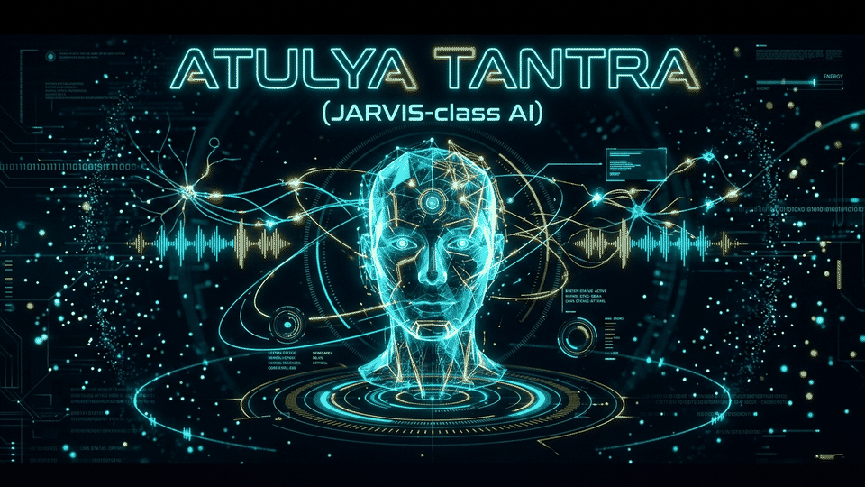
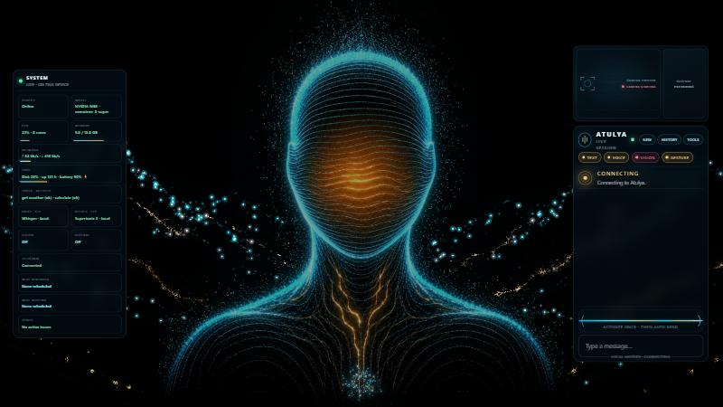
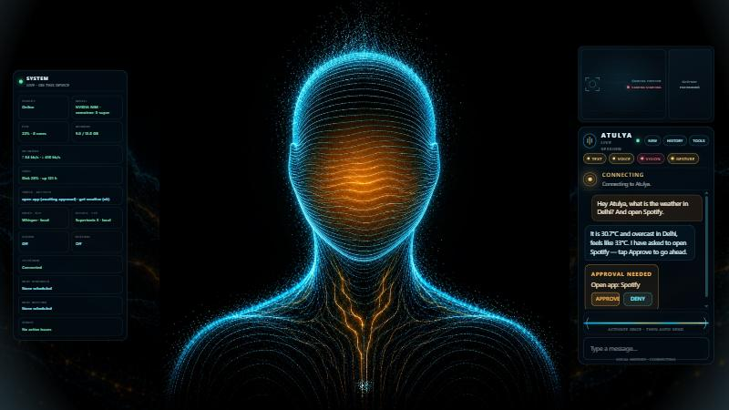
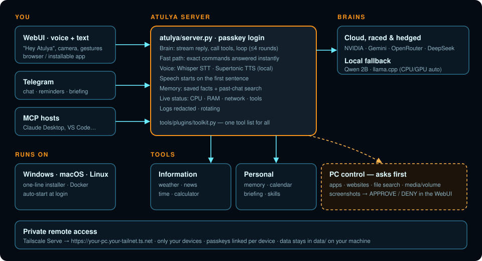

<!-- Hero Banner -->
<div align="center">
  
</div>

<div align="center">
  <h1>
    
  </h1>
</div>

<p align="center">
  <em><strong>अतुल्य</strong> (Atulya) — Peerless, without equal &nbsp;·&nbsp; <strong>तन्त्र</strong> (Tantra) — System, loom of intelligence</em><br/>
  <strong>A personal AI you talk to: a glowing particle hologram that listens in Hindi and English, remembers you, and acts for you — only with your approval.</strong>
</p>

<p align="center">
  <a href="https://www.python.org/downloads/"></a>
  <a href="LICENSE"></a>
  <a href="#privacy"></a>
  <a href="#jarvis-features"></a>
  <a href="#install"></a>
  <a href="#"></a>
</p>

```
 +---------------------------------------------------------------------------+
 |                          HOW ATULYA WORKS                                 |
 |                                                                           |
 |  "Hey Atulya" / text --> hologram WebUI (webui/) --> server (atulya/)     |
 |                                   |                                       |
 |                                   v                                       |
 |          brain: streams the reply and calls tools by itself               |
 |            /                  |                    \                      |
 |   cloud models, raced    memory: saved facts    tools: weather, news,     |
 |   + local Qwen fallback  + past-chat search     calendar, skills, PC      |
 |            \                  |                    /                      |
 |           safety: PC actions wait for APPROVE / DENY                      |
 +---------------------------------------------------------------------------+
```

---

Atulya opens straight into a living hologram. Talk to it ("Hey Atulya…") or type; it answers out loud
sentence by sentence, can be interrupted mid-reply, and uses tools on its own — weather, news, maths,
your memories and meetings, multi-step skills — and, after you approve, your computer.

<p align="center">
  
  
</p>
<p align="center"><sub>Left: the scene with the live system panel. Right: an example exchange — Atulya answers, and asks before opening an app.</sub></p>

<p align="center">
  
</p>

---

## Install

**Android app:** download the newest signed APK from **https://atulya.atulvij.com/download** (or [GitHub Releases](https://github.com/atulyaai/Atulya-Tantra/releases/latest)).

**Windows** (PowerShell, no admin rights):

```powershell
irm https://raw.githubusercontent.com/atulyaai/Atulya-Tantra/main/install.ps1 | iex
```

**Linux / macOS** (x86-64 or ARM64, including Raspberry Pi):

```bash
curl -fsSL https://raw.githubusercontent.com/atulyaai/Atulya-Tantra/main/install.sh | sh
```

The installer downloads Atulya into `~/Atulya-Tantra`, reuses Python 3.10+ or installs a private Python 3.12 with
[uv](https://docs.astral.sh/uv/), creates `.venv`, copies `.env.example` to `.env`, and prepares models sized to the
machine (it detects OS, CPU, RAM and GPU; GPU offload when available; the offline model is skipped under 6 GB RAM).

| Option | What it does |
|---|---|
| `-Service` (Windows) / `--service` (Linux, macOS) | Start Atulya automatically at login (Task Scheduler, systemd user unit, LaunchAgent) |
| `-RemoveService` / `--remove-service` | Remove the login service; your data is kept |
| `start.bat` / `./start.sh` | Run from an existing checkout (falls back to the installer when Python is missing) |

**Docker** (servers, NAS, Raspberry Pi):

```bash
docker build -t atulya .
docker run -d --name atulya -p 127.0.0.1:8501:8501 --env-file .env \
  -v atulya-data:/app/data -v atulya-models:/app/models atulya
```

Then open **http://localhost:8501** and create your admin passkey (Windows Hello, Touch ID, phone or security key).

---

## Brains

Atulya tries the configured cloud models first — at most two at once, the fastest wins — and falls back to a local
model that works offline. Put keys in `.env` (comma-separated keys and models are tried one by one):

| Brain | Settings | Notes |
|---|---|---|
| NVIDIA NIM | `NVIDIA_API_KEY`, `ATULYA_NVIDIA_MODEL` | Tried first in automatic mode |
| Gemini | `GEMINI_API_KEY`, `ATULYA_GEMINI_MODEL` | Also understands camera frames |
| OpenRouter | `OPENROUTER_API_KEY`, `ATULYA_OPENROUTER_MODEL` | Free `:free` models work |
| DeepSeek | `DEEPSEEK_API_KEY`, `ATULYA_DEEPSEEK_MODEL` | |
| Local Qwen 3.5 2B | automatic | llama.cpp, downloaded once into `models/`; never leaves your PC |
| Ollama / any OpenAI-compatible API | `ATULYA_MODEL_PROVIDER=ollama` or `openai-compatible` | Bring your own |

`ATULYA_MODEL_PROVIDER=local` keeps chat fully offline. Every tool works with every brain; models that do not support
tool calling fall back to plain chat automatically.

---

## Jarvis features (live)

| Ability | How to use it | State |
|---|---|---|
| Voice | Say stop, repeat, mute, wake word on, barge-in on. Mic auto-starts after first permission. | Working |
| Short replies | Persona is Jarvis-style (1–2 sentences, no filler). Greeting is time-aware. | Working |
| Tools | Weather, news, web search, places, routes, Gmail/Calendar (after Google re-auth), routines. | 40 tools loaded |
| Routines | Weekday 08:00 briefing (~40 words), 07:30 rain check, 08:15 calendar reminder. | Working |
| Vision | Free multimodal model (gemma-4). Allow camera for live view. | vision_ready true |
| Gesture | MediaPipe model on disk. Thumbs up/down, open palm. | Model ready · needs camera |
| Memory | remember / recall / search past chats. | Basic |
| Telegram | Allowlisted ID merges into admin account. | Working |
| Laptop agent | Outbound agent code present. Start on PC with token. | Code ready |

Full list: **[docs/TODO.md](docs/TODO.md)**. Architecture: **[docs/ARCHITECTURE.md](docs/ARCHITECTURE.md)**.

---

## Reach it from anywhere — privately

1. Install [Tailscale](https://tailscale.com/download) on the PC and on your phone, signed in to the same account, and
   enable **HTTPS certificates** in the Tailscale admin console.
2. Run `.venv/Scripts/python -m atulya.cli remote --enable` (Windows) or `.venv/bin/python -m atulya.cli remote --enable`.
3. Restart Atulya, then on the PC open **USERS → LINK MY PHONE / ANOTHER DEVICE** and open that link on the phone to
   add a passkey there.

Only your own devices can reach `https://<pc>.<tailnet>.ts.net`; no router ports are opened, and `localhost` keeps
working. For a public server, see [docs/REMOTE_ACCESS.md](docs/REMOTE_ACCESS.md).

---

## Privacy

- Speech recognition (Whisper), speech output (Supertonic), gestures and the fallback model run **on your machine**.
- With a cloud brain selected, your chat text (and camera frame, if you ask about it) goes to that provider.
- Accounts use passkeys and server-side sessions; chats, memory, calendar and logs stay in `data/` and are never committed.
- Logs redact API keys and bot tokens and rotate at 2 MB.

---

## Layout

| Folder | Purpose |
|---|---|
| `atulya/` | Core app: HTTP API, passkey auth, settings, chat history, system metrics, CLI |
| `tools/plugins/` | Capabilities by area: `brain/`, `communications/`, `voice/`, `information/`, `personal/`, `productivity/`, `utilities/`, `system/` (PC control) |
| `tools/plugins/toolkit.py` | The one tool list shared by the model, Telegram and MCP |
| `tools/skills/` | Workflow instructions (`SKILL.md`) |
| `tools/mcp/` | Optional MCP server (stdio) |
| `webui/` | The hologram scene, renderer, chat and status panels, PWA files |
| `docs/` | Architecture, remote access, integrations catalog, TODO / status |
| `tests/` | Core, providers, plugins, voice, MCP and end-to-end tests |
| `data/`, `models/` | Your private data and downloaded models — created at runtime, git-ignored |

More detail: **[docs/ARCHITECTURE.md](docs/ARCHITECTURE.md)**.

---

## Development

```bash
python -m pytest -q            # 54 tests, no paid API calls
ruff check .                   # lint
node --check webui/assistant.js
python -m atulya.cli doctor    # quick configuration check
```

## Contributing

Contributions, bug reports, and ideas are welcome!

1. **Fork** the repository
2. **Create** a feature branch: `git checkout -b feat/your-feature`
3. **Commit** your changes: `git commit -m "feat: add your feature"`
4. **Push** and open a **Pull Request**

Keep PRs focused and include tests. New tools go in `tools/plugins/toolkit.py`; anything that changes the computer
must set `confirm=True` so it waits for the user's approval.

> All contributions are released under the [MIT License](LICENSE).

## License

MIT License. Copyright (c) 2026 Atulya AI (atulyaai). The Atulya WebUI scene, character artwork and renderer are part
of this project. See [LICENSE](LICENSE) and [webui/ATTRIBUTION.txt](webui/ATTRIBUTION.txt).
